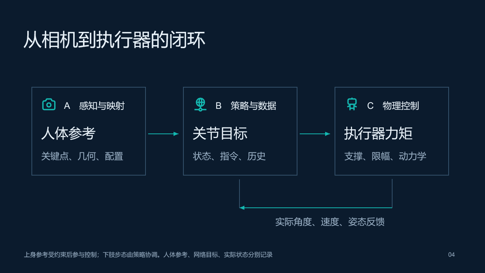
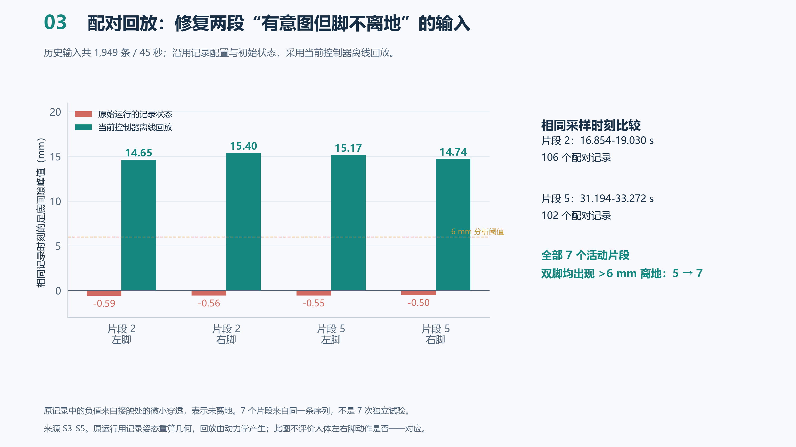

# G1 Vision Teleoperation

**用普通 RGB 摄像头控制 MuJoCo 中的宇树 G1，并记录人体参考、控制意图与机器人实际状态。**

这是人工智能控制课程的仿真项目：将预训练人体姿态估计、几何关节映射、已有步态策略和物理控制接入同一条反馈链路。支持 DJI Osmo Action 3 的 USB Webcam 模式，也支持 OpenCV 能读取的其他相机。



默认模式支持上身动作跟随和人体踏步意图触发的物理迈步。下肢由已有策略协调，尚未实现任意舞蹈逐帧复刻。当前验证对象为官方 G1 29 关节 MuJoCo 模型，没有验证特定 G1 Pro 实机配置。

[安装与使用](docs/GETTING_STARTED.md) · [技术架构](docs/ARCHITECTURE.md) · [实验结果与限制](docs/VALIDATION.md) · [课程答辩材料](docs/course/README.md) · [第三方来源](THIRD_PARTY_NOTICES.md) · [English](docs/README_EN.md)

## 能做什么

- **物理迈步跟随（默认）**：正常重力、自由基座和脚地接触，向执行器写入力矩，由 MuJoCo 积分运动。
- **固定双脚的上身跟随**：在站立支撑约束下跟随人体上身动作。
- **全身影子预览**：直接设置姿态，检查关节映射和转向；此模式不验证动力学平衡。
- **可视化关节映射**：在本地 HTML 编辑器中调整人体通道、机器人关节、方向、范围和偏置。
- **采样与回放**：自动就位、标定、倒计时和“采样结束”提示，保存控制日志与物理统计。

另附简化机械臂、智元 X1 双臂和 TWIST2 全身跟随实验入口。TWIST2 真人相机测试曾跌倒，属于实验功能，见 [G1_TRACKING_zh.md](G1_TRACKING_zh.md)。

## 快速开始（Windows）

本项目在 Windows、64 位 Python 3.14 环境验证。需要摄像头、图形桌面和网络；机器人模型与步态策略已随源码保留，MediaPipe 权重由安装脚本下载。

```powershell
git clone https://github.com/momodexiaolanmao/g1-vision-teleop.git
Set-Location -LiteralPath '.\g1-vision-teleop'
powershell -ExecutionPolicy Bypass -File .\setup.ps1
.\start_unitree_g1.cmd
```

启动后有 8 秒走到相机前。让头、双手和双脚完整入镜，站直、双脚落地、手臂自然下垂，稳定约 1.5 秒后自动标定。先缓慢摆臂，再缓慢交替提膝。看到低可信或脚部遮挡提示时，调整站位。

| 按键 | 功能 |
|---|---|
| C | 重新开始就位与标定 |
| N | 重选人物，再按 C |
| 空格 | 暂停／继续 |
| R | 重置仿真并重新标定 |
| Q / Esc | 退出 |

没有相机时，可先运行机械臂合成输入演示：

```powershell
.\.venv\Scripts\python.exe teleop.py --demo --headless --seconds 10
```

## 用什么技术

| 层次 | 技术 | 核心文件 |
|---|---|---|
| 人体识别 | MediaPipe Tasks Pose Landmarker Full，单人 33 关键点 | `teleop.py`、`subject_tracker.py` |
| 关节映射 | 向量夹角、身体坐标系、atan2、范围换算、质量门控 | `pose_retarget.py`、`joint_mapping.py` |
| 迈步意图 | 足部画面变化、膝弯曲、持续时间与请求保持 | `footstep_intent.py` |
| 步态策略 | Unitree 预训练 ONNX；96 维观测、5 帧历史、29 维动作 | `g1_locomotion.py` |
| 物理控制 | 站立逆动力学 QP、迈步 PD、限幅与阶段切换 | `standing_balance.py`、`hybrid_balance.py` |
| 日志与交互 | 状态文件、输入回放、自动采样与完成提示 | `control_trace.py`、`sampling_session.py` |

项目使用已有的 MediaPipe 和 Unitree 权重，没有将它们描述为自行训练的模型。人体角度参考、网络输出目标和机器人实际关节状态分别记录。

## 已有实验结果

| 验证内容 | 记录结果 | 结论范围 |
|---|---|---|
| Full 多人上限 3 改单人 | 关键点短时变化指标 5.740 → 2.531 px，下降 55.9% | 同帧配对，没有姿态真值 |
| Full 质量过滤 | 帧间角度变化指标 0.934 → 0.569°，下降 39.0% | 整段标准差仅下降约 0.4% |
| 历史输入踏步回放 | 满足双脚各自曾离地 >6 mm 的活动片段 5/7 → 7/7 | 同一条序列，片段非独立试验 |
| 历史压力回归 | 23.228 s 触发跌倒 → 完成 180 s 窗口未记录跌倒 | 每组各一次，历史快照有限 |
| 单轮真人物理复测 | 25 s，左右脚最高离地约 1.98 / 1.81 cm，最高倾角 6.13° | 峰值力矩占用 100%，仍有饱和 |

这些指标不能换算成识别准确率、总体成功率或任意舞蹈的稳定保证。详见 [验证说明](docs/VALIDATION.md) 和 [完整优化报告](docs/evidence/优化过程_数据图表报告.pdf)。



## 仓库结构

```text
teleop.py / *.py              运行模块、验证与回放工具
*_mapping.json / *.html       映射配置与本地可视化编辑器
start_*.cmd / setup.ps1       Windows 安装与启动入口
robots/                      G1 / TWIST2 / X1 模型与各自许可证
policies/                    已有步态权重、部署配置与来源哈希
fixtures/                    机器人目标向量与上游动作样例
test/、test_*.py              自动回归与物理验证
docs/                        安装、架构、证据、答辩 PPT 与讲稿
models/                      本地下载的 MediaPipe 权重（不提交）
artifacts/                   本地运行日志和采样输出（不提交）
```

为保持导入关系和启动脚本可用，运行模块保留在仓库根目录。没有将原工作目录中的虚拟环境、缓存、第三方完整仓库和重复答辩版本一起上传。

## 测试与贡献

快速回归入口：

```powershell
.\.venv\Scripts\python.exe scripts/run_checks.py
```

较长的物理测试：

```powershell
.\.venv\Scripts\python.exe scripts/run_checks.py --full
```

私有相机姿态轨迹没有公开，对应现场输入用例会明确跳过。详细验证范围见 [docs/VALIDATION.md](docs/VALIDATION.md)。欢迎提交可复现问题和改进，见 [CONTRIBUTING.md](CONTRIBUTING.md)。

## 开源许可与数据

项目原创代码和文档采用 [MIT](LICENSE)。第三方模型、策略和样例继续适用各自许可证，详见 [THIRD_PARTY_NOTICES.md](THIRD_PARTY_NOTICES.md)。

公开版答辩 PPT 保留技术图、5 个可编辑数据图表和备注，移除了个人相机录屏及其封面画面。未发布原始人体关键点轨迹、现场 JSONL、账号凭据或本机虚拟环境，详见 [公开材料范围](docs/PUBLICATION_SCOPE.md)。
