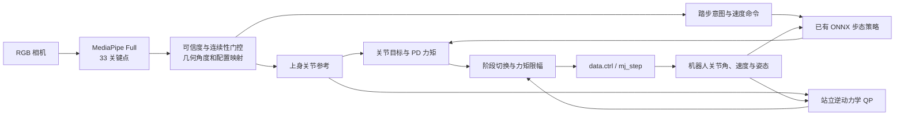
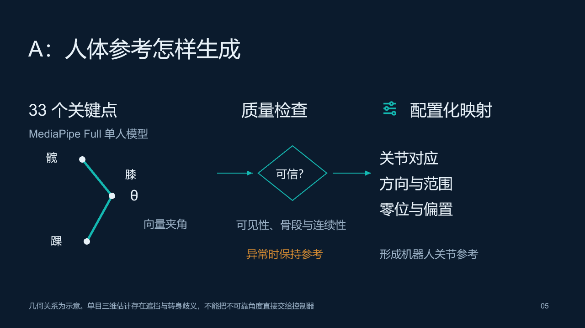
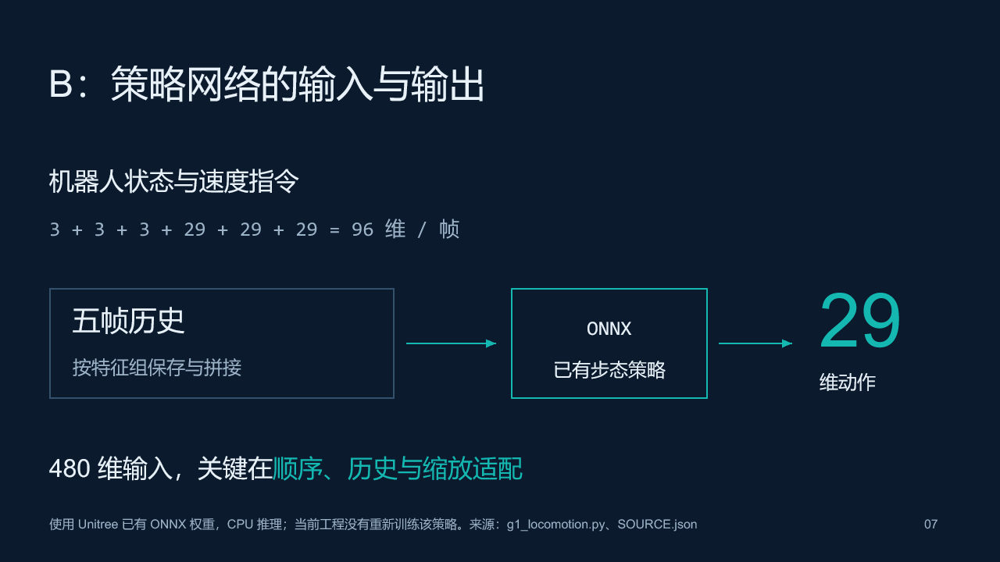
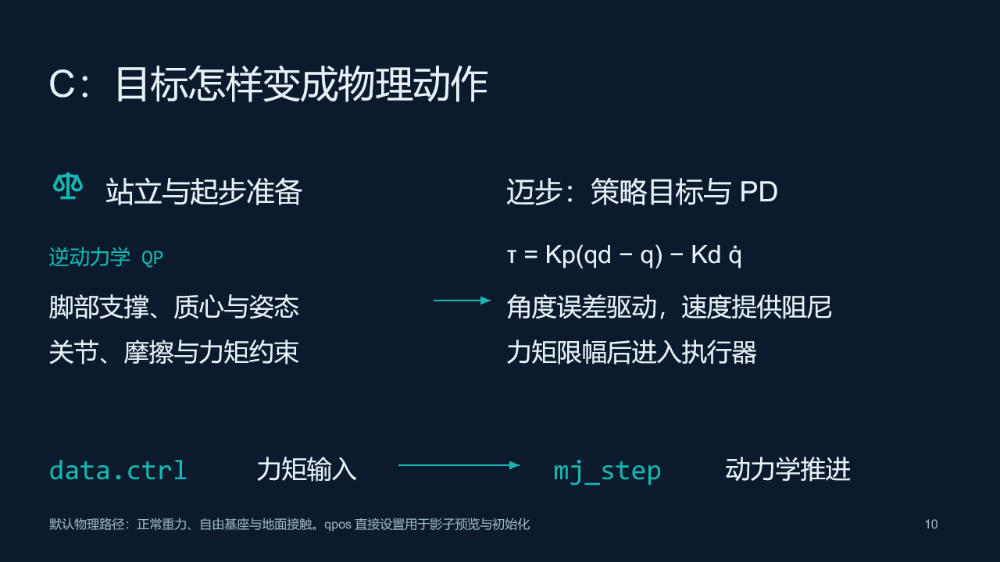

# 技术架构

## 从视觉参考到物理反馈

姿态识别网络、几何映射、步态策略和运动控制分别负责不同接口。相机估计的是人体，控制器的闭环反馈来自 MuJoCo 机器人的状态。

## A：视觉识别与映射

MediaPipe Tasks Pose Landmarker Full 使用已有单人预训练权重，输出 33 个关键点及质量信息。膝、肘等关节通过向量夹角计算，肩髋与身体朝向还使用身体坐标系和 atan2。配置定义通道到机器人关节的对应、方向、范围和偏置。

可见性、骨段、连续性、静止和异常值处理降低不可靠参考直接进入控制器的风险。缺失或低可信通道保持原参考。人物选择基于躯干位置与大小，不是身份识别。单目深度、遮挡和转身仍有歧义。

## B：策略适配与数据

默认步态权重来自 Unitree `unitree_rl_lab`。单帧观测为角速度 3、重力方向 3、速度命令 3、关节角误差 29、关节速度 29、上一动作 29，合计 96 维。五帧历史形成 480 维输入，输出 29 维动作。历史按特征组拼接，关节顺序、默认姿态和缩放需与训练配置一致。

策略在 CPU 使用 ONNX Runtime。相机请求 30 FPS、策略 50 Hz、物理 500 Hz 是不同层次的配置周期，不能直接作为端到端延迟。

日志区分人体参考、控制意图、策略目标和机器人实际状态。现有功能是数据入口与回放基础，尚未建立规范训练集或训练自主行为克隆策略。

## C：物理控制

站立和起步准备采用逆动力学 QP，将脚部支撑、质心和姿态任务与约束一起处理。迈步阶段策略给出关节目标，PD 由角度误差和关节速度产生力矩，再限幅写入 `data.ctrl`。`mj_step` 在重力和接触下推进状态。

`hybrid_balance.py` 处理站立、准备、迈步与收步的切换。默认路径不靠持续修改自由基座 qpos 或外加身体支撑力站立。初始化、重置、独立运动学对象中的 qpos 赋值与持续影子跟随具有不同用途。

## 模式边界

影子模式直接设置姿态，用于检查映射。默认物理模式依靠执行器驱动。TWIST2 路径是单独的全身跟随实验，官方参考回放通过，但现有真人相机输入记录曾跌倒。

尚未验证任意舞蹈、跳跃、人体与机器人脚相位严格同步或实体机器人部署。
